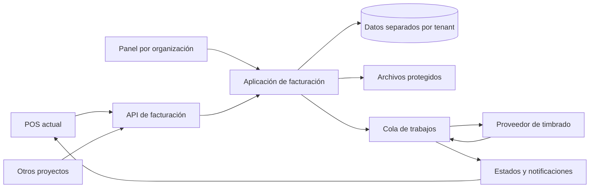

# Próximos pasos: plataforma de facturación multiempresa

Fecha: 16 de octubre de 2026.
Estado: propuesta para el siguiente proyecto; la plataforma de facturación todavía no está implementada.

## 1. Objetivo

Crear un proyecto independiente de facturación que puedan utilizar distintas empresas, agencias y aplicaciones. Cada organización tendrá su espacio, usuarios y documentos separados, con acceso desde un panel web y desde una API.

El POS actual será uno de los sistemas conectados. Desde una venta se podrá solicitar una factura y consultar después su estado, XML y representación en PDF.

## 2. Decisiones acordadas y propuestas

### Acordado en la conversación

- La facturación se desarrollará como proyecto independiente.
- Se conectará con este POS y podrá atender otros proyectos.
- Los datos de cada empresa o agencia deben permanecer separados.
- Cada usuario solo podrá consultar aquello para lo que tenga acceso.

### Propuesta técnica pendiente de confirmar

- Laravel para el servidor, el panel administrativo y la API.
- Una base de datos compartida con separación por organización (`tenant_id`).
- Archivos y credenciales separados y protegidos por organización.
- Integración con un proveedor de timbrado mediante una capa que permita cambiar de proveedor.
- Nombre provisional del repositorio: `innovatecode-facturacion`.

Compartir una base no significa compartir acceso a los datos. La separación debe verificarse en el servidor, las consultas, los trabajos en segundo plano y las descargas. Si una empresa requiere una base exclusiva, esa necesidad se evaluará antes de cerrar la arquitectura.

## 3. Preguntas que resolver antes de programar

- [ ] ¿Una agencia factura únicamente con su propio RFC o administra varias empresas con RFC distintos?
- [ ] ¿Agencia y empresa tendrán espacios independientes con acceso delegado, o la agencia será propietaria de un espacio con varios emisores?
- [ ] ¿Cada cliente contratará su propio proveedor de timbrado o la plataforma administrará una cuenta con varios emisores?
- [ ] ¿Se necesita una base exclusiva para algún cliente o basta con separación lógica?
- [ ] ¿Quién podrá crear organizaciones e invitar usuarios?
- [ ] ¿La primera versión será de uso interno o se ofrecerá como servicio a terceros?
- [ ] ¿Qué documentos y operaciones fiscales se necesitan en la primera entrega?

No asumir que un usuario, una agencia, una empresa y un RFC son la misma entidad. Tampoco asignar acceso a todos los clientes de una agencia sin una autorización explícita.

## 4. Modelo de acceso propuesto

| Concepto | Responsabilidad |
| --- | --- |
| Organización / tenant | Espacio que delimita los datos y el acceso. |
| Usuario | Persona que inicia sesión; puede pertenecer a varias organizaciones. |
| Membresía | Relación entre usuario, organización y rol. |
| Emisor | Identidad fiscal y configuración con la que se emiten documentos. |
| Proyecto conectado | POS, tienda u otra aplicación autorizada para consumir la API. |
| Credencial de API | Acceso revocable con permisos y emisores autorizados para un proyecto. |

Roles iniciales sugeridos dentro de cada organización:

- **Propietario:** configuración de la organización y administración de accesos.
- **Administrador:** emisores, usuarios y operación de facturación según sus permisos.
- **Facturista:** preparar y emitir documentos para los emisores autorizados.
- **Consulta:** consultar y descargar documentos autorizados.

La administración de la plataforma será un acceso distinto de los roles de cada organización. No dará acceso automático al contenido fiscal; cualquier acceso de soporte deberá ser explícito y quedar auditado.

## 5. Arquitectura de conexión



Reglas principales:

1. El servidor obtiene la organización autorizada desde la sesión y la membresía, o desde la credencial de API.
2. Enviar un `tenant_id`, `issuer_id` o identificador de factura no concede acceso por sí solo.
3. Cada referencia entre cliente, emisor, proyecto y documento se valida dentro de su organización.
4. Las credenciales de un proyecto no permiten acceder a los demás proyectos u organizaciones.
5. Una falla de timbrado no bloquea el registro de ventas del POS. La facturación conserva su propio proceso y estado.

## 6. Primera versión funcional

### Administración y seguridad

- [ ] Crear organizaciones y configurar sus datos.
- [ ] Invitar usuarios y asignar roles por organización.
- [ ] Permitir cambiar de organización solo entre membresías autorizadas.
- [ ] Registrar proyectos y emitir credenciales de API revocables.
- [ ] Registrar acciones sensibles en una bitácora.

### Facturación

- [ ] Configurar emisores y proteger sus certificados y secretos.
- [ ] Registrar y validar clientes fiscales.
- [ ] Crear borradores con conceptos, impuestos y datos fiscales.
- [ ] Integrar un proveedor en ambiente de pruebas.
- [ ] Solicitar timbrado y consultar resultados.
- [ ] Conservar UUID y XML timbrado; generar o recuperar el PDF correspondiente.
- [ ] Consultar documentos por fecha, cliente, emisor, folio, UUID y estado.
- [ ] Descargar XML y PDF con autorización en cada solicitud.
- [ ] Solicitar cancelaciones y consultar su resolución.

La solicitud de cancelación y su resultado son estados distintos. No mostrar una factura como cancelada solo porque se envió la solicitud.

### Integración con el POS

- [ ] Incorporar el botón **Facturar venta** con un permiso específico.
- [ ] Capturar o confirmar los datos fiscales del receptor.
- [ ] Enviar una copia de la venta y guardar la referencia de la factura.
- [ ] Mostrar estado, UUID y opciones de descarga.
- [ ] Permitir consultar el resultado de solicitudes pendientes sin generar otra factura.

## 7. Datos mínimos del nuevo proyecto

| Entidad | Datos principales |
| --- | --- |
| Organizaciones | Identificador, nombre y estado. |
| Membresías e invitaciones | Usuario, organización, rol y estado de acceso. |
| Emisores | Organización, identidad fiscal, configuración y referencias a secretos protegidos. |
| Proyectos y credenciales | Organización, nombre, permisos, emisores autorizados y revocación. |
| Clientes fiscales | Organización y datos fiscales del receptor. |
| Facturas | Organización, emisor, proyecto de origen, estado, importes, UUID y referencias a archivos. |
| Conceptos | Copia de descripción, claves fiscales, cantidades, precios e impuestos. |
| Intentos y eventos | Solicitudes al proveedor, respuestas sanitizadas y cambios de estado. |
| Idempotencia | Proyecto, operación, clave de reintento, huella de la solicitud y resultado. |
| Entregas de notificaciones | Destino, firma, intentos y confirmación. |
| Auditoría | Actor, organización, acción, documento y fecha. |

Los documentos deben conservar una copia de los datos con los que se emitieron. Cambiar después el nombre del cliente o el precio de un producto no debe modificar una factura emitida.

## 8. Contrato inicial de API

Rutas propuestas, sujetas a diseño definitivo:

```text
POST /api/v1/invoices                 Crear borrador desde un proyecto
POST /api/v1/invoices/{id}/issue      Solicitar timbrado
GET  /api/v1/invoices/{id}            Consultar estado y resultado
GET  /api/v1/invoices/{id}/xml        Descargar XML autorizado
GET  /api/v1/invoices/{id}/pdf        Descargar PDF autorizado
POST /api/v1/invoices/{id}/cancel     Solicitar cancelación
```

- Autenticación mediante token de proyecto enviado en el encabezado, nunca en la URL.
- Permisos separados para crear, emitir, consultar, descargar y cancelar.
- Clave de idempotencia para operaciones que puedan generar duplicados.
- Reutilizar la misma clave con un contenido distinto debe producir un conflicto.
- Estados consultables, errores claros, identificador de seguimiento y límites de solicitudes.
- Notificaciones firmadas y con protección frente a repetición; la consulta de estado será el respaldo si no llega una notificación.

Si hay un tiempo de espera al contactar al proveedor, el resultado puede ser desconocido. Primero se debe reconciliar el intento; un reintento no debe timbrar automáticamente un segundo documento.

## 9. Preparación fiscal de la integración

Antes de implementar y publicar, confirmar con la documentación vigente del SAT y del proveedor:

- [ ] Datos y validaciones de emisor y receptor.
- [ ] Claves de productos, servicios y unidades para los conceptos del POS.
- [ ] Tratamiento de impuestos, descuentos y redondeos.
- [ ] Diferencia entre forma de pago, método de pago y uso del comprobante.
- [ ] Operaciones con público general, facturas globales y complementos que realmente necesite el negocio.
- [ ] Requisitos de certificados, cancelaciones y conservación de documentos.

No asumir que las categorías comerciales del POS equivalen a las claves fiscales, ni que el nombre del método de cobro resuelve toda la configuración fiscal.

Referencias iniciales:

- [Portal de factura electrónica del SAT](https://www.sat.gob.mx/minisitio/Factura/).
- [Lista de proveedores autorizados de certificación](https://www.sat.gob.mx/portal/public/tramites/lista-de-proveedores-autorizados-de-certificacion-de-cfdi).
- [Proceso de cancelación del SAT](https://www.sat.gob.mx/minisitio/Factura/cancela_procesocancelacion.htm).

## 10. Orden de trabajo

### Fase 0 — Definición

Resolver las preguntas de la sección 3 y documentar el modelo de organizaciones, emisores, acceso de agencias y alcance fiscal. Elegir proveedor de pruebas después de comparar sus capacidades y condiciones.

**Resultado:** alcance aprobado y esquema de entidades.

### Fase 1 — Proyecto independiente y aislamiento

Crear el repositorio, autenticación, organizaciones, membresías, roles, proyectos y credenciales. Implementar primero pruebas con dos organizaciones que intenten acceder a datos ajenos.

**Resultado:** separación comprobada desde la web, la API, los archivos y las colas.

### Fase 2 — Borradores y consulta

Implementar emisores, clientes fiscales, conceptos, cálculos, estados y buscador de documentos, todavía sin timbrado real.

**Resultado:** crear y consultar borradores completos con permisos correctos.

### Fase 3 — Proveedor en pruebas

Integrar timbrado, consulta, XML/PDF, cancelaciones, idempotencia y reconciliación de intentos inciertos.

**Resultado:** flujo completo validado en el ambiente de pruebas del proveedor.

### Fase 4 — Conexión del POS

Añadir la configuración de conexión y el botón Facturar venta. Vincular las referencias y probar reintentos y fallas de comunicación.

**Resultado:** facturar una venta desde este POS sin capturar nuevamente sus conceptos.

### Fase 5 — Preparación para producción

Configurar HTTPS, secretos cifrados, respaldos y restauración, correo real, monitoreo de trabajos, auditoría y operación del servicio. Pasar a timbrado real después de validar los casos fiscales requeridos.

**Resultado:** plataforma operable con un procedimiento documentado de soporte y recuperación.

## 11. Criterios para dar por terminada la primera versión

- [ ] Una organización no puede leer, modificar, emitir ni descargar documentos de otra.
- [ ] Un usuario con varias membresías solo accede al espacio seleccionado y autorizado.
- [ ] Revocar una credencial impide nuevas solicitudes autenticadas con ella.
- [ ] Los reintentos no generan facturas duplicadas.
- [ ] Un resultado incierto del proveedor se puede consultar y reconciliar.
- [ ] Los certificados, claves privadas y tokens no aparecen en logs, respuestas o repositorios.
- [ ] XML y PDF requieren autorización; conocer una ruta de almacenamiento no concede acceso.
- [ ] Las facturas emitidas conservan su información original.
- [ ] Las cancelaciones muestran la resolución real del proceso.
- [ ] Se puede facturar desde el POS y consultar el resultado aunque se interrumpa la conexión.
- [ ] Las pruebas no usan timbrado real ni modifican datos de clientes reales.
- [ ] Existe una prueba de restauración de respaldos y una guía de operación.

## 12. Punto de partida para la próxima sesión

Comenzar por la **Fase 0** y resolver si una agencia administrará varios RFC y espacios independientes. Después crear el proyecto independiente y desarrollar el aislamiento entre organizaciones antes de conectar el proveedor o el POS.

Este archivo define los siguientes pasos. No crea el nuevo proyecto, no contrata un proveedor y no activa timbrado real.
